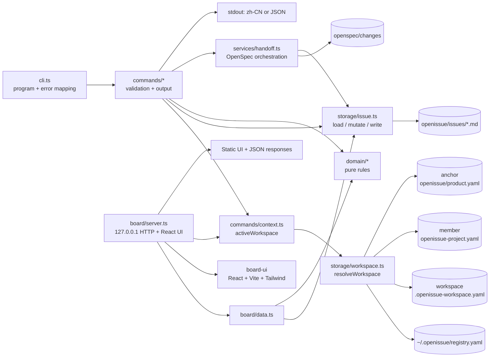

# Repository Guidelines

OpenIssue is a Git-native requirement inbox for product engineers: capture an idea with only a title, keep the record in the product's spec/issue anchor repo, explain priority with rules + an external assistant, and enter OpenSpec through a product decision interview when it matures. This repo is the CLI implementation; requirement data and OpenSpec plans live in the sibling anchor repo `../OpenIssue-spec-issue/`.

## Project Overview

- Single source of truth: one Markdown file per issue, stored only in the anchor repo. Member repos hold a pointer, never a copy.
- Single-user, Git-shared. No accounts, assignees, comments, labels, milestones, notifications, GitHub Issues sync, or permanent delete.
- Lifecycle is binary: `open` / `closed`; a closed issue must say `completed` or `wontdo` (+ note). "Deferred" = stay open.
- User-facing text, errors, and docs are zh-CN. Code identifiers, error codes, YAML keys, and CLI flags are English.
- All v1 surfaces are implemented: CLI, local board, assistant `prioritize --emit/--apply`, OpenSpec interview entry/handoff, search/filter, and installable Agent skills. See [Implementation Status](#implementation-status).

## Architecture & Data Flow



| Layer    | Path            | Rule                                                                             |
| -------- | --------------- | -------------------------------------------------------------------------------- |
| Entry    | `src/cli.ts`    | Assembles Commander, maps errors to exit codes                                   |
| Commands | `src/commands/` | Commander wiring, input validation, console output; no raw fs                    |
| Board    | `src/board/`    | HTTP server, shared board data, React UI, and static asset serving              |
| Services | `src/services/` | Cross-layer orchestration (OpenSpec process + metadata + issue links)            |
| Core     | `src/core/`     | Types, errors, IDs, paths, hashing, author, guards                               |
| Domain   | `src/domain/`   | Pure functions only (no I/O)                                                     |
| Storage  | `src/storage/`  | Filesystem, YAML/frontmatter, atomic writes, workspace resolution; no CLI output |

**Resolution order** (`src/storage/workspace.ts`): explicit `--anchor` → nearest ancestor with `openissue/product.yaml` → nearest ancestor with `openissue-project.yaml` (use registry `anchor_path`, then pointer-local `anchor`) → nearest `.openissue-workspace.yaml` → `unregistered`. A present but invalid workspace pointer throws with `--rescan`/`--anchor` repair guidance; it never silently falls through. Multiple resolvable products return `ambiguous` until `--product` is supplied. Never silently pick. `commands/context.ts` converts the typed context into `ActiveWorkspace` or throws the zh-CN guidance error.

**Data layout**

```text
<workspace>/
  .openissue-workspace.yaml        # version, product, anchor only; no members/issues
  .agents/skills/                  # shared OpenIssue + promoted OpenSpec skills
  AGENTS.md                        # OPENISSUE managed index section
  <id>/                            # code repo
    README.md, .gitignore, AGENTS.md, openissue-project.yaml
  <id>-spec/                       # anchor
    README.md, AGENTS.md
    openissue/product.yaml         # id, name, focus, focus_updated_at, members[]
    openissue/issues/OI-YYYYMMDD-XXXX.md
    openspec/                      # optional; specs/ + changes/
<member>/
  openissue-project.yaml           # products: [{ id, anchor? }] — committed pointer
$OPENISSUE_HOME/registry.yaml      # default ~/.openissue; products.<id>.anchor_path
```

Single-repo init uses the current repo as anchor with no workspace pointer or root `AGENTS.md` index. `init` scans only direct children for `openissue/product.yaml` or complete OpenSpec data; a config-only `openspec/config.yaml` with `store:` is a pointer repo and is excluded.

**Issue file**: YAML frontmatter + Markdown body. Fields: `id`, `title`, `status`, `product`, `created_at`, `updated_at`, `author`, `source`, optional `close {reason, note?, closed_at}`, `blocked_by[]`, `proposals[]`, `priority {tier, order, reason, basis, judged_at, input_hash, source, manual_tier, manual_at}`. Description is the body; a `description` frontmatter key is deleted on write. Unknown frontmatter keys are preserved via `rawFrontmatter` — do not drop them.

**Read/write flow**: `loadIssues()` reads every `*.md`, sorts by `created_at` then `id`, and returns `{ issues, conflicts }`. Parse failures and duplicate IDs become `conflicts` (raw preserved) and are printed to stderr as `需要处理：…`; they never abort a read. Mutations go through `mutateIssue()`, which re-reads, applies the mutator, bumps `updated_at`, and writes atomically (`write-file-atomic`). Commands validate before mutating so a failed command leaves the file untouched.

**Priority evaluation** (`src/domain/priority.ts`): groups `high | medium | low | unassessed`, in that display order. Base tier = `priority.manual_tier` else cached `priority.tier`, else `unassessed`. Invalid dependency (missing blocker or `wontdo` blocker) forces `unassessed` while retaining the manual value. Floor propagation lifts a blocker to the highest tier among open, tiered downstream issues; it never lowers a blocker and ignores unassessed/closed downstream. Order within a group: cached `priority.order`, then dependency depth, then `created_at`, then `id`. Dependency edges are explicit only — never infer from text similarity.

**Path resolution must stay cross-platform**: always `node:path`; format paths for display/JSON with `toPosix()`. Windows and POSIX are both supported and tested.

## Key Directories

| Directory                           | Purpose                                                                                                                                                                                                      |
| ----------------------------------- | ------------------------------------------------------------------------------------------------------------------------------------------------------------------------------------------------------------ |
| `src/commands/`                     | Command families: `init.ts` (workspace/single/new project entry), `register.ts` (manual member registration), `create.ts`, `edit.ts`, `list.ts` (list/show), `lifecycle.ts` (close/reopen), `dependencies.ts` (depend/undepend), `priority.ts`, `focus.ts`, `tier.ts`, `start.ts` (interview entry/complete/discard), `handoff.ts` (link/confirm), `board.ts`, `skills.ts`, `context.ts` |
| `src/board/`                        | `server.ts` HTTP routes/actions, `data.ts` shared board data, `snapshot.ts` full UI view model, `types.ts` board contract, `ui/` React + Vite + Tailwind interface |
| `src/services/`                     | `workspace-init.ts` anchor/member discovery, pointer, new project scaffold, phases/retry; `handoff.ts` OpenSpec metadata (`x-openissue-issues`, `x-openissue-interview`), interview entry context, resume/discard, archive detection, snapshot diff |
| `src/skills/`                       | `catalog.ts` bundled asset loading + tool table; `manifest.ts` hash manifest; `install.ts` install/status/update + OpenSpec `.agents/skills` promotion |
| `skills/`                           | Four installable `SKILL.md` workflows; initialization lives in README, not a skill |
| `src/core/`                         | `types.ts` canonical schema; `errors.ts`; `id.ts` ID/slug generation; `paths.ts`; `hash.ts`; `author.ts`; `guards.ts`                                                                                        |
| `src/domain/`                       | Pure rules: `dependencies.ts`, `priority.ts`, `assistant.ts`, `search.ts`, `lifecycle.ts`, `manual.ts`                                                                                                       |
| `src/storage/`                      | `issue.ts`, `product.ts`, `registry.ts`, `workspace.ts` (member + workspace pointers), `openspec.ts` (OpenSpec data/store detection), `frontmatter.ts`, `atomic.ts`, `facts.ts`                                      |
| `src/types/`                        | Ambient declaration for `write-file-atomic`                                                                                                                                                                  |
| `test/helpers/`                     | Temp-repo fixtures and `runCli` harness                                                                                                                                                                      |
| `test/unit/`, `test/integration/`   | Vitest suites                                                                                                                                                                                                |
| `.github/workflows/`                | CI matrix                                                                                                                                                                                                    |
| `../OpenIssue-spec-issue/openspec/` | Specs, proposal, design, tasks; `changes/establish-openissue-v1/` is the v1 contract                                                                                                                         |

## Development Commands

| Task                  | Command                                                                      |
| --------------------- | ---------------------------------------------------------------------------- |
| Install               | `pnpm install`                                                               |
| Build (server tsc + UI Vite → `dist/`) | `pnpm build`                                             |
| Build UI only         | `pnpm build:ui`                                                              |
| Dev UI only           | `pnpm dev:ui` (Vite proxies `/api` to `127.0.0.1:4310`)                      |
| Global local install/update | `pnpm build && npm uninstall -g openissue && npm install -g --install-links . --offline` |
| Type check only       | `pnpm typecheck`                                                             |
| Dev CLI (no build)    | `pnpm dev -- --help`                                                         |
| Run built CLI         | `node dist/cli.js --version`                                                 |
| All tests             | `pnpm test`                                                                  |
| Watch tests           | `pnpm test:watch`                                                            |
| Single file           | `pnpm exec vitest run test/integration/lifecycle.test.ts`                    |
| Filter by name        | `pnpm test -- dependencies`                                                  |
| E2E                   | `pnpm test:e2e` — builds the board UI, then runs Playwright in `test/e2e/board.spec.ts` (`PLAYWRIGHT_CHANNEL=chrome` to use system Chrome locally) |
| Product E2E           | `pnpm e2e:product` — anchor + two members, real OpenSpec archive |
| Skills smoke          | `node dist/cli.js skills list` — loads bundled Markdown from package root |

There is no lint or format script. Do not invent one; match existing style. CI runs `pnpm install --frozen-lockfile`, installs OpenSpec 1.10, then `pnpm build`, `pnpm test`, Playwright install + `pnpm test:e2e`, and `pnpm e2e:product`. Remote GitHub Actions has not been run in this workspace.

## Code Conventions & Common Patterns

- **ESM only**: `"type": "module"`, NodeNext. Relative imports MUST end in `.js` (`import { x } from './core/errors.js'`). Use `node:` builtins. Use `import type` for types. Named exports only; no default exports.
- **Strict TS**: `strict`, `noUncheckedIndexedAccess`, `exactOptionalPropertyTypes`. Never assign `undefined` to an optional property — use conditional spread: `...(note ? { note } : {})`. Indexed access needs proof (`files[0]!` only after a length check, or `??` fallback). Prefer interfaces + string unions over enums/classes.
- **Errors**: throw `new OpenIssueError(messageZh, 'UPPER_CODE', exitCode?)`. Default exit code is 1; `CONCURRENT_MODIFICATION` uses 2. Never call `process.exit()` in a command; `runCli()` catches and sets `process.exitCode`. Error codes are stable contract; messages are user-facing Chinese.
- **Command shape**: export `registerXCommand(program: Command)`, register with `.command('<name> [arg]')`, `.option()`, `.action(async (...) => {...})`. Read global flags via `command.optsWithGlobals() as { product?: string; anchor?: string }`, then call `activeWorkspace(process.cwd(), { ...(productId ? { productId } : {}), ...(anchorPath ? { anchorPath } : {}) })`. Register new command families in `src/cli.ts`.
- **Output**: human output is `console.log` zh-CN; every read/write command supports `--json` with `JSON.stringify(value, null, 2)`. Warn about conflicts on `console.error`. `publicIssue()` strips `filePath` and `rawFrontmatter`; JSON shapes are `{issues, conflicts}`, `{groups, closed, conflicts}`, `{id, path, issue}`, etc.
- **Storage**: all writes via `writeTextAtomic()`; all issue updates via `mutateIssue()`; serialize with `serializeMarkdown()`/`YAML.stringify(..., { lineWidth: 0 })`; preserve unknown frontmatter. Do not use `fs.writeFile` for product data.
- **Naming**: files lowercase/kebab; functions camelCase verb-first (`loadIssues`, `assertCanDepend`); constants UPPER\_SNAKE; types PascalCase; error codes UPPER\_SNAKE; YAML keys snake\_case; CLI flags kebab-case. Issue IDs `OI-YYYYMMDD-XXXX` (Crockford alphabet, no I/L/O/U); OpenSpec change IDs lowercase ASCII slug ≤64 chars, fallback to lowercase issue ID.
- **Async**: `node:fs/promises`, `async/await`, no callbacks. Read order is explicit and deterministic (`readdir(...).sort()`).
- **Domain purity**: `src/domain/` must not import `node:fs`; keep scoring and cycle logic unit-testable.
- **Skills assets**: keep `skills/<name>/SKILL.md` Markdown-first; frontmatter `name` MUST equal the directory, `description` must be non-empty, and the directory must stay in npm `files`. Installers MUST preflight all target conflicts before writing and MUST NOT overwrite user edits without `--force`.
- **Language**: code/spec SHALL/MUST keywords stay English; product behavior text is zh-CN. Keep proposal/spec changes in the sibling repo, not here.

## Important Files

| File                                                               | Why it matters                                                                                                          |
| ------------------------------------------------------------------ | ----------------------------------------------------------------------------------------------------------------------- |
| `src/cli.ts`                                                       | Entry point, `createProgram()`, global `--anchor`/`--product`, command registration, error → exit code; version comes from `src/core/version.ts` |
| `src/core/version.ts`                                              | Single `VERSION` source; must match `package.json`                                                                      |
| `src/commands/context.ts`                                          | `activeWorkspace()`; canonical zh-CN errors for unregistered/ambiguous/missing states                                   |
| `src/storage/workspace.ts`                                         | Anchor/member/registry resolution; `MEMBER_FILE = 'openissue-project.yaml'`; `WORKSPACE_FILE = '.openissue-workspace.yaml'`; legacy pointer migration |
| `src/storage/openspec.ts`                                          | Complete OpenSpec data vs store-pointer detection; `openspec init` invocation |
| `src/commands/init.ts`                                             | Init flags, `--zh/--en`, TUI/non-interactive dispatch, JSON error envelope, report output |
| `src/services/workspace-init.ts`                                   | Anchor/member scanning, confirmations, pointer writes, scaffold, AGENTS index, phase reporting |
| `src/services/init-plan.ts`                                        | Read-only init plan: mode detection, anchors, members, OpenSpec/Skills choices, write paths |
| `src/services/init-tui.ts`                                         | Full-screen TUI state machine, step wizard, language switch, review, retry/exit |
| `src/core/language.ts`                                             | `zh`/`en` resolution, system-locale mapping, explicit/workspace/last-explicit precedence |
| `src/storage/preferences.ts`                                       | `$OPENISSUE_HOME/preferences.yaml` language preference storage and inheritance |
| `test/integration/workspace-init.test.ts`                          | Root pointer, discovery, members, scaffold, skills/AGENTS, failure/retry coverage |
| `test/integration/init-language.test.ts`                           | Language flags, persistence, inheritance, OpenSpec language, JSON errors |
| `test/unit/init-plan.test.ts` / `init-tui.test.ts`                 | Plan model, TUI key handling, wizard journey, cancel/language switch |
| `src/storage/issue.ts`                                             | Schema parsing, conflict collection, atomic mutation, `publicIssue()`                                                   |
| `src/storage/product.ts`                                           | `openissue/product.yaml` read/write; `initProduct`, `addMember`                                                         |
| `src/storage/registry.ts`                                          | `$OPENISSUE_HOME/registry.yaml`; machine-local anchor paths                                                             |
| `src/storage/frontmatter.ts`                                       | Frontmatter regex/CRLF normalization, YAML round-trip                                                                   |
| `src/domain/priority.ts`                                           | Grouping, manual/cached precedence, dependency floor, stable ordering, input hash |
| `src/domain/dependencies.ts`                                       | `assertCanDepend`, cycle detection, open-blocker helpers                                |
| `src/domain/assistant.ts`                                          | `--emit` request shape and `--apply` validation                         |
| `src/domain/search.ts`                                             | Search and combination filters                                          |
| `src/commands/start.ts`                                            | `start` entry, agent instruction, active/interview state, complete/discard gates |
| `src/services/handoff.ts`                                          | OpenSpec link/archive/snapshot orchestration and interview metadata     |
| `src/skills/install.ts`                                            | Skill install/status/update; interview-skill availability check         |
| `src/skills/catalog.ts`                                            | Bundled skill loading, frontmatter validation, tool/alias table        |
| `skills/*/SKILL.md`                                                | Agent-facing workflows: capture, triage, grill-me, handoff             |
| `src/board/server.ts`                                              | Local HTTP server, UI asset serving, board API actions, legacy API compatibility |
| `src/board/ui/App.tsx`                                             | Four-tab board React shell: board, dependencies, OpenSpec, workspace    |
| `test/e2e/board.spec.ts`                                           | Playwright board/search/single-user coverage                            |
| `src/core/types.ts`                                                | Canonical `Issue`, `ProductManifest`, `PriorityView*` shapes                                                            |
| `test/helpers/fixtures.ts`                                         | `createAnchor`, `createMember`, `runCli`, registry fixtures                                                             |
| `tsconfig.json`                                                    | NodeNext/ESM + strictness settings that shape every file                                                                |
| `.github/workflows/ci.yml`                                         | Ubuntu + Windows, Node 22/24, build → test                                                                              |
| `../OpenIssue-spec-issue/openspec/changes/establish-openissue-v1/` | v1 requirements, scenarios, review matrix, task status                                                                  |

## Runtime/Tooling Preferences

- Node.js **>= 22** (CI: 22 and 24). Verified locally on Node 26. No CommonJS output.
- **pnpm** only (`pnpm-lock.yaml`; CI installs pnpm 12). Do not use npm/yarn or hand-edit the lockfile. `engines` is enforced; `packageManager` is not pinned.
- CLI/server build is plain `tsc`; the board UI is built by Vite into `dist/board-ui/`. No path aliases or decorators. `dist/` is generated and gitignored; `bin.openissue` points to `dist/cli.js` (shebang present). `test/` is excluded from the server build, so tests run TypeScript via `tsx`.
- Runtime dependencies: `commander` (CLI), `yaml` (YAML), `write-file-atomic` (safe writes). Board UI libraries are dev/build dependencies: `react`, `react-dom`, `react-markdown`, `remark-gfm`, `lucide-react`, `vite`, `@vitejs/plugin-react`, `tailwindcss`, `@tailwindcss/vite`, plus React type packages; Vite bundles them into `dist/board-ui/` so global installs do not fetch UI libraries at runtime.
- Windows is first-class: use `path.join/resolve`, `toPosix` for display, and platform-aware binaries (`openspec.cmd` on win32). Never hardcode `/`.
- No ESLint/Prettier/EditorConfig and no coverage tool. Keep diffs focused; do not add tooling or dependencies without need.

## Testing & QA

- **Runner**: Vitest, `test/**/*.test.ts`, `test/e2e/**` excluded, 20s test/hook timeout. Current suite: 21 files / 165 tests. No coverage thresholds.
- **Layers**: `test/unit/{paths,language,init-plan,init-tui}.test.ts` (pure helpers, language, plan, TUI state), `test/fixtures.test.ts` (fixture smoke, invokes real `openspec`), `test/smoke.test.ts` (CLI version), `test/integration/{capture,edit,workspace,workspace-init,init-language,lifecycle,dependencies,priority,assistant,handoff,grill-entry,board,search,skills}.test.ts` (real CLI/board + temp dirs), `test/e2e/board.spec.ts` (Playwright).
- **Integration harness**: `runCli(args, { cwd, env })` spawns `node node_modules/tsx/dist/cli.mjs src/cli.ts …`; **no build required**. Always isolate with `OPENISSUE_HOME=<temp>/.home` and `OPENISSUE_AUTHOR=测试作者`. Track temp dirs and clean them in `afterEach` via `Promise.all(cleanup.splice(0).map(x => x.cleanup()))`.
- **Assertions are behavioral**: exit status, expected-language stderr substrings, on-disk YAML/body, and `--json` stdout. Tests deliberately assert raw file equality when a command must not mutate data. Prefer these over mocking internals.
- **Cross-platform expectations**: every path-related change must work on Windows and POSIX; specs additionally require a POSIX-separator fixture (already covered by `workspace.test.ts`).
- **When changing behavior**: add/update the integration test that exercises the observable contract; keep `no delete`, mandatory close reason, conflict visibility, and dependency-floor semantics intact. Run the narrowest file with `pnpm exec vitest run <file>`, then `pnpm test` and `pnpm typecheck`.
- **CI** (`.github/workflows/ci.yml`): matrix ubuntu/windows × node 22/24 → install, install OpenSpec 1.10, build, test, Playwright install + `pnpm test:e2e`, then `pnpm e2e:product`. Remote Actions has not been run in this workspace; treat that as an external verification gap.
- `test/fixtures.test.ts` requires the OpenSpec CLI on `PATH` (uses `openspec.cmd` on Windows); it is otherwise offline. No network calls in tests.

## Implementation Status

`establish-openissue-v1`, `add-openissue-skills`, and `adopt-grill-me-entry` are archived. `add-workspace-init` has all 71 tasks complete and is validated, including the visual init, language preference, and Agent JSON work. Archive remains a separate step after the dependency order is confirmed.

Implemented:

- CLI capture/edit/list/show, lifecycle, dependencies, focus, manual tiers, priority display.
- Local board with shared storage, `127.0.0.1` binding, and a full React UI: priority lanes/list, issue inspector, dependency chains/editing, OpenSpec fact pages and archive actions, workspace/file inspection, conflict area, and assistant emit/apply console.
- Assistant protocol: `prioritize --emit` request with focus/facts/hashes and `--apply` validation with partial-result isolation.
- OpenSpec interview entry and handoff: `start`, active-proposal takeover, `x-openissue-interview` incomplete/completed state, explicit `start --complete` transition, resume/discard, `--link` association, snapshot diff, archive detection, and explicit completion confirmation.
- OpenSpec facts (specs, active/archived proposals, task progress), input-hash cache/staleness, and manual/rule precedence.
- Cross-platform CI workflow, Playwright suite, and full-product end-to-end script.
- Four installable Agent skills (`openissue-capture/triage/grill-me/handoff`) with `openissue skills list|install|status|update`, hash manifest conflict protection, and default `init` installation to `.agents/skills`. Initialization is documented in README and is not a skill, so a fresh install never depends on an already-installed skill.
- `openissue init` workspace discovery: lightweight `.openissue-workspace.yaml` pointer, OpenIssue/complete-OpenSpec anchor candidates, store-pointer exclusion, member preselection/conflicts, single-repo in-place init, new-project `<id>/` + `<id>-spec/` scaffold, OpenSpec agents promotion, managed root `AGENTS.md` index, and phase-aware failure/retry reporting.
- `openissue init` visual flow: TTY-only full-screen navigation, auto-detected mode/language first screen, dynamic step wizard, grouped review, skills conflict handling, `--json` non-interactive contract, structured `init` failures, and retry/exit after partial writes.
- `openissue init --zh/--en`: system-default language (`zh*` Chinese, other English), explicit → workspace → last-explicit → system precedence, per-workspace `$OPENISSUE_HOME/preferences.yaml`, new-workspace inheritance, localized human text, and OpenSpec artifact language for new projects only.
- `openissue start` interview entry with active-proposal takeover, incomplete-interview resume/discard, explicit `--complete` status transition, Board copyable context, and `handoff --link` as the only manual association path.

Known gaps / external conditions:

- GitHub Actions has not been run remotely in this workspace; only the equivalent local commands have been verified.
- `pnpm test:e2e` builds the UI first. If downloaded Playwright Chromium is unavailable, run with `PLAYWRIGHT_CHANNEL=chrome`; the same 5 board tests pass with system Chrome in this workspace.
- `src/core/version.ts` and `package.json` must stay in sync; a test enforces it.
- Multi-product sharing of one anchor repo remains a deferred design question, as recorded in the change design.
- `../OpenIssue-spec-issue/openspec/changes/establish-openissue-v1/tasks.md` is now 71/71 checked; future scope changes should go through a new OpenSpec change and `openspec validate --strict`.

<br />

