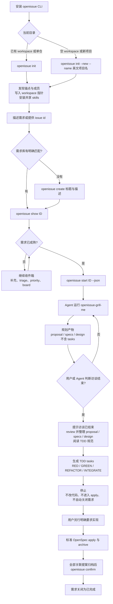
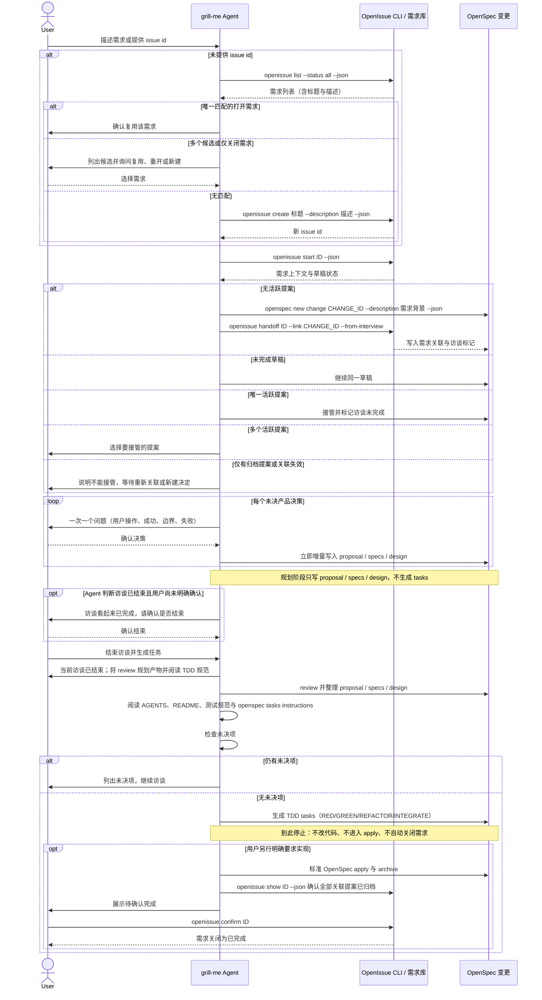

# OpenIssue

Git 原生的需求收件箱，面向产品开发工程师（或者 产品经理）。它接住那些“值得做、现在做不了、也还写不出 spec”的想法；等想法成熟后，再交给 OpenSpec。

需求只保存一份：在产品锚点仓库的 `openissue/issues/` 中。成员代码仓库只保存 `openissue-project.yaml` 指针，不保存副本。GitHub Issues 不在实现范围。

## 什么时候你需要它

- 将多个 repo 定义为一个产品矩阵，多个 repo 之间存在依赖关系；
- 产品矩阵中，每个 repo 都有多个需求，需求之间存在优先级、依赖关系、实现状态等；
- 一个issue可能存在需要同时更改多个 repo 情况。

## 环境

- Node.js >= 22
- pnpm >= 10
- 可选：OpenSpec CLI（`openspec` 1.10+，交接功能需要）

## 安装与开发

```bash
pnpm install
pnpm build
pnpm test
node dist/cli.js --version
```

如果要在当前 shell 中直接使用 `openissue`：

```bash
pnpm link --global
openissue --version
```

### 本地全局安装与更新（npm）

`pnpm link --global` 适合临时开发。需要安装一个与 npm 发布包一致、能稳定执行的全局副本时，从仓库根目录构建并用 npm 复制安装：

```bash
pnpm install
pnpm build
npm uninstall -g openissue
npm install -g --install-links . --offline
openissue --version
```

一条命令完成安装
```bash
pnpm build && npm uninstall -g openissue && npm install -g --install-links . --offline
```

源码变更后更新全局副本：

```bash
pnpm build
npm uninstall -g openissue
npm install -g --install-links . --offline
openissue init --help
```

说明：

- `--install-links` 把本地包复制到全局目录，不创建符号链接；避免 npm 全局 shim 通过符号链接执行时出现入口判断问题。
- `--offline` 只使用本地依赖缓存。若安装失败，先运行 `pnpm install`，必要时去掉 `--offline` 让 npm 解析依赖。
- 这是从当前工作树安装，不发布到 npm registry。
- 全局包只包含 `dist` 与 `skills`；源码变更后必须先 `pnpm build`，否则全局命令仍运行旧构建。

端到端验证：

```bash
pnpm exec playwright install chromium
pnpm test:e2e
pnpm e2e:product
```

`pnpm e2e:product` 会在临时目录创建“锚点 + 两个成员仓库”的完整产品，走通捕获、优先级、依赖、OpenSpec 交接与归档确认。

## 配套 Agent skills

OpenIssue 随包提供四份 Agent workflow skills：

- `openissue-capture`：把想法或 bug 捕获为需求，只记录不实现；
- `openissue-triage`：按项目事实、依赖与手动覆盖审阅优先级；
- `openissue-grill-me`：从成熟需求开始产品决策访谈，自动创建提案草稿并增量写入 proposal/specs/design；用户明确结束访谈后才生成 TDD tasks；
- `openissue-handoff`：重新关联已有提案，并在全部关联提案归档后由用户确认完成。

初始化不是随包 skill。首次接入请按本文“快速开始”运行 `openissue init`；初始化完成时才会安装上述 skills，避免“必须先安装 onboard 才能初始化”的循环。

查看并安装：

```bash
openissue skills list
openissue skills install                          # 默认 .agents/skills
openissue skills install --tool claude,opencode   # 指定工具
openissue skills install --tool all               # 所有受支持目录
```

支持 `agents`、`claude`、`opencode`、`cursor`、`github-copilot`、`qwen`、`gemini`、`trae`、`oh-my-pi`；`codex` 是 `agents` 的别名。只做项目内安装，不写用户主目录。

已安装的 skill 用 `.openissue-skills.json` 记录内容哈希。再次安装不会覆盖用户修改；确认要覆盖时显式使用 `--force`。检查与升级：

```bash
openissue skills status
openissue skills update
```

`status` 只读显示 `缺失`、`已安装`、`待更新`、`已修改`、`未托管`。`update` 只更新未修改的托管副本；未指定 `--tool` 时只处理已检测到的目录。

`init` 默认把全部随包 skills 安装到 workspace 根 `.agents/skills`；`--skills none` 明确跳过；`--skills` 不带值等价于 `agents`。其他工具目录不会由 `init` 写入：

```bash
openissue init
openissue init --skills none
openissue skills install --tool claude,opencode
```

skills 随 npm 包分发；`pnpm pack` 可用于检查打包内容。

## 使用流程

### 总体使用流程



### 与 OpenSpec 交接的业务流程



边界说明：

- 没有 OpenIssue 来源的直接 OpenSpec 请求仍走标准 propose，不创建 OpenIssue 草稿。
- `openissue handoff --link` 只用于重新关联已有提案；命令会提示该路径跳过产品决策访谈。
- 用户或 Agent 判断访谈结束时，Agent 必须先提示访谈已经结束；若用户尚未确认，先请求确认。确认后 review 并整理 proposal/specs/design，阅读项目 TDD 规范与 OpenSpec tasks instructions，再生成符合 TDD 的 tasks。
- 访谈中断时草稿与关联保留，需求保持打开；丢弃草稿必须二次确认。
- 已归档提案不能被接管；全部关联提案归档后仍需用户明确确认，系统不自动关闭需求。

## 数据布局

多仓 workspace 的根只保存共享入口，不保存需求数据：

```text
<workspace>/
  .openissue-workspace.yaml # version、product、anchor；不保存成员或需求
  .agents/skills/           # 根共享 skills
  AGENTS.md                 # 带 OPENISSUE 标记的索引段落
  <id>/                     # 代码仓
    README.md
    .gitignore
    AGENTS.md
    openissue-project.yaml
  <id>-spec/                # spec/issue 锚点
    README.md
    AGENTS.md
    openissue/
      product.yaml          # 产品 id、名称、当前重点、成员列表
      issues/
        OI-YYYYMMDD-XXXX.md # YAML frontmatter + Markdown 描述
    openspec/               # 标准 OpenSpec 结构（CLI 可用时）
```

单 Git 仓原地初始化时，当前仓就是锚点，不创建 `.openissue-workspace.yaml`，也不创建 workspace 根 `AGENTS.md` 索引。

成员仓库只保存指针：

```yaml
products:
  - id: demo
    anchor: ../demo-spec
```

workspace 根命令（`list`、`start`、`board` 等）通过 `.openissue-workspace.yaml` 解析锚点；成员关系始终从锚点的 `openissue/product.yaml` 读取。本机注册表默认在 `~/.openissue/registry.yaml`；可用 `OPENISSUE_HOME` 覆盖。

## 快速开始

### 1. 初始化 workspace

**既有 workspace**：在 workspace 根运行：

```bash
openissue init
```

系统只扫描直接子目录：已有 `openissue/product.yaml` 的仓库、或含完整 `openspec/specs` / `openspec/changes` 的规范仓会成为锚点候选；只有 `openspec/config.yaml` store 指针的代码仓会被排除。唯一候选自动复用；多个候选必须用 `--anchor <path>` 选择。确认后会写出轻量指针，并让用户选择成员仓库。

**全新项目**：在空 workspace 运行：

```bash
openissue init --new --name "Demo Product"
```

项目名必须是英文；`Demo Product` 会规范化为 `demo-product`，并创建 `demo-product/` 代码仓与 `demo-product-spec/` spec 仓。两个仓库只执行 `git init`，不会自动提交，也不会生成技术栈脚手架。空 workspace 未提供 `--name` 时，交互式终端会提示输入英文项目名。

**单 Git 仓**：在当前仓根运行：

```bash
openissue init --id demo --name "Demo 产品"
```

当前仓原地成为锚点；如果在 Git 仓子目录运行，会提示到仓根或指定锚点，不会创建嵌套仓库。

`init` 默认安装全部随包 skills 到 workspace 根 `.agents/skills`；`--skills none` 跳过。若锚点是单独的 spec 仓，OpenSpec 在 spec 仓生成的 `.agents/skills` 会合并到 workspace 根，并在成功校验后移除 spec 仓副本。

缺少 OpenSpec 时会先询问；交互式终端可确认补初始化，脚本中使用 `--openspec` 或 `--no-openspec`。OpenSpec CLI 不可用或初始化失败时，OpenIssue 与仓库仍会保留，并报告未完成项。

已有指针失效时，使用以下任一方式明确修复，不会静默改选：

```bash
openissue init --rescan
openissue init --anchor <锚点路径>
```

#### 可视化界面

在交互式终端（TTY）且未传 `--json` 时，`openissue init` 会进入全屏可导航界面：

- 首屏显示检测到的模式、判断依据、当前语言与可改选入口；
- 按步骤处理环境与语言、产品/锚点、成员、Skills、OpenSpec 与 Review；
- 单仓会跳过锚点/成员，已有 workspace 指针会跳过重复发现；
- Review 展示选择、将写入路径与跳过项；确认前不写产品数据；
- 执行失败保留已创建内容，结果页只提供“重试 / 退出”。

`--json` 即使运行在 TTY 中也强制非交互，不会启动可视化界面或等待键盘输入。

#### 语言

```bash
openissue init --zh
openissue init --en
```

- 默认跟随系统语言：`zh*` 使用中文，其他及无法识别的语言使用英文。
- 优先级为：显式 `--zh` / `--en` → 当前 workspace 偏好 → 最近一次显式设置 → 系统语言。
- 语言偏好按 workspace/产品独立保存，位置为 `$OPENISSUE_HOME/preferences.yaml`；新 workspace 会继承最近一次显式设置。
- 显式选择会立即保存；取消初始化不会回滚语言偏好，但不会写入产品数据。
- 语言覆盖初始化界面、可读输出与本次新建 OpenSpec 产物的语言；已有 OpenSpec 不会因语言切换被改写。
- `--zh` 与 `--en` 互斥；同时使用会返回 `LANGUAGE_CONFLICT`，不启动界面、不写入、不更新偏好。
- `--help` 静态文案暂不随语言切换。

#### Agent 初始化指令

Agent 必须使用显式 flags 与 `--json`，不要尝试操作可视化界面：

```bash
# 既有 workspace，显式选择锚点并接受预选成员
openissue init --anchor ../demo-spec --yes --skills agents --json

# 全新项目
openissue init --new --name "Demo Product" --yes --skills agents --json

# 单仓原地初始化
openissue init --id demo --name "Demo Product" --yes --json

# 修复失效指针
openissue init --rescan --json
```

缺少多锚点选择、成员确认或 OpenSpec 选择时，`--json` 会返回结构化错误而不是提问。失败时 stdout 输出统一外壳：

```json
{
  "mode": "unknown",
  "status": "failed",
  "error": { "code": "ANCHOR_SELECTION_REQUIRED", "message": "..." },
  "phases": [],
  "created": [],
  "next": ["openissue init --anchor <path> --zh --json"],
  "language": "zh",
  "language_source": "system"
}
```

Agent 用 `error.code` 判断失败类型，用 `next` 继续；部分失败使用 `status: "partial"`，并保留已创建内容。键名、错误码与 `next` 命令不翻译；`message` 与 `warnings` 跟随所选语言。

### 2. 登记成员仓库

初始化既有 workspace 时会列出直接子 Git 仓：store 指针匹配锚点的仓预选，其他仓可选，已归属其他产品的仓标记冲突且默认不选。确认后成员仓库获得 `openissue-project.yaml`，锚点 `product.yaml` 记录成员。

手动补登记仍可使用：

```bash
openissue register --anchor ../demo-spec
```

手动登记会跳过 workspace 初始化中的锚点发现与成员确认；正常情况下优先从 workspace 根运行 `openissue init`。

一个仓库登记到多个产品时，后续命令必须用 `--product <id>` 明确选择。

### 3. 捕获需求

```bash
openissue create "接入第三方账单"
openissue create "接入第三方账单" --description "需要先确认鉴权方式"
```

只有标题是必填的。所属产品、创建时间、作者与来源由系统自动记录；来源为命令行。

### 4. 查看与编辑

```bash
openissue list
openissue list --status closed
openissue list --status all
openissue show OI-20261120-ABCD
openissue edit OI-20261120-ABCD --title "新的标题"
openissue edit OI-20261120-ABCD --description "补充后的描述"
openissue edit OI-20261120-ABCD --description ""
```

默认只显示打开项。关闭项需要显式筛选。

### 5. 当前重点

```bash
openissue focus "先跑通需求收件箱"
openissue focus
openissue focus --clear
```

当前重点是可选的一句话；设置后助手判断可以引用它，留空时只使用项目事实。`focus` 会显示最后更新时间。

### 6. 优先级

```bash
openissue priority
openissue priority --json
```

输出按高、中、低、待评估分组，并显示每条需求的理由、依赖与手动/待刷新标记。

规则立即生效：关闭项排除、依赖失效、依赖下限、手动档位、助手判断。没有助手结果时，需要语义判断的需求显示“待评估”，不会被默认归入某一档。

手动设定与恢复：

```bash
openissue tier OI-20261120-ABCD high
openissue tier OI-20261120-ABCD medium
openissue tier OI-20261120-ABCD auto
```

手动值会保留；依赖下限或失效依赖可以覆盖有效档位，约束解除后手动值恢复。

### 7. 助手判断

```bash
openissue prioritize --emit > priority-request.json
openissue prioritize --apply priority-response.json
```

`--emit` 只输出打开需求、当前重点、规范/提案/任务进度与输入哈希；不包含关闭项，也不要求模型账号或密钥。助手返回的格式：

```json
{
  "version": 1,
  "results": [
    {
      "id": "OI-20261120-ABCD",
      "tier": "high",
      "reason": "当前重点要求先完成账单接入",
      "basis": ["focus"],
      "order": 0,
      "input_hash": "从请求中原样带回"
    }
  ]
}
```

`--apply` 会校验档位、理由、依据与 `input_hash`，按需求隔离错误。部分结果有效时，只写入有效项；其余保持原状态或“待评估”。输入已变化的结果会被拒绝，需要重新 `--emit`。

### 8. 依赖

```bash
openissue depend OI-20261120-AAAA OI-20261120-BBBB
openissue undepend OI-20261120-AAAA OI-20261120-BBBB
```

第一条阻塞第二条。只支持这一种显式关系，不自动推断；循环会被拒绝且不写入。前置为“已完成”时解除阻塞；前置为“不做”时下游进入“待评估”，直到移除或替换依赖。

### 9. 关闭与重新打开

```bash
openissue close OI-20261120-ABCD --reason completed
openissue close OI-20261120-ABCD --reason wontdo --note "方向已调整"
openissue reopen OI-20261120-ABCD
```

关闭必须选择“已完成”或“不做”；“不做”必须填写原因。重新打开会保留原关闭原因。没有永久删除入口。

关闭已关联提案的需求时，界面会说明提案不会因此取消或改变。

### 10. 交给 OpenSpec

从需求开始产品决策访谈：

```bash
openissue start OI-20261120-ABCD
openissue start OI-20261120-ABCD --json
```

也可以直接把需求描述交给 Agent，而不先提供 id。Agent 会先读取需求库查重：唯一明确匹配则复用，多个候选则让你选择，只有已关闭需求则询问重开或新建；没有相关需求时，用 `openissue create` 创建，再运行 `openissue start <id>` 进入访谈。

`start` 只输出需求上下文与可交给 Agent 的启动指令，不创建提案、不改需求。把输出交给 Agent 后，`openissue-grill-me` 会：

1. 用 `openspec new change` 创建提案草稿；
2. 用 `openissue handoff <id> --link <change> --from-interview` 建立关联并写入 `x-openissue-issues` 与 `x-openissue-interview`；
3. 每确认一项决策就增量写入 proposal、specs 或 design；
4. 只有用户明确说“结束访谈并生成任务”后才写 tasks，生成后停止。

需求保持打开；访谈未完成会同时显示在需求与草稿上。再次运行 `start` 会继续同一草稿；丢弃草稿必须二次确认：

```bash
openissue start OI-20261120-ABCD --discard <change-id> --yes
```

`handoff --change` 不再直接创建提案，会提示改用 `start`。只有重新关联已有活跃提案时仍使用：

```bash
openissue handoff OI-20261120-ABCD --link existing-change
```

该路径会明确提示跳过了产品决策访谈。关联时只新增关联信息，不复制或改写提案内容。

当全部关联提案归档后：

```bash
openissue confirm OI-20261120-ABCD
```

只有用户确认才会关闭为“已完成”；系统不会自动关闭。部分归档、已关闭需求或关联失效时不会出现完成提示。

### 11. 启动 Web 看板

在 workspace 根或锚点仓运行：

```bash
openissue board
```

默认启动在 `http://127.0.0.1:4310/`，并自动打开浏览器。终端会显示实际访问地址，按 `Ctrl+C` 停止：

```text
看板已启动：http://127.0.0.1:4310/
仅绑定 127.0.0.1；按 Ctrl+C 停止。
```

常用选项：

```bash
openissue board --port 4311       # 换端口
openissue board --no-open         # 不自动打开浏览器
openissue board --port 4311 --no-open
openissue board --port 0           # 当端口被占用时,可使用port 0 由系统自动选择空闲端口
```

看板只绑定 `127.0.0.1`，与命令行读写同一份数据。可以：

- 按高/中/低/待评估查看，看到理由、依赖、提案与手动/待刷新标记；
- 调整档位、关闭或重新打开；
- 编辑当前重点；
- 按标题/描述搜索，并按状态、档位、关联提案、阻塞状态组合筛选；
- 处理关联失效、归档确认与冲突记录。

看板不提供创建需求或编辑标题/描述的入口；捕获由命令行负责。看板也没有账号、负责人、评论、通知或实时协作。

## 冲突与损坏记录

无法解析的 frontmatter（包括 Git 合并冲突）不会让看板崩溃。它会在独立的“需要处理的记录”区域显示文件名、错误与原始内容，且不受搜索/筛选隐藏。

处理方式：

1. 打开对应文件，修复 YAML 或解决 Git 冲突；
2. 保留未知 frontmatter 字段；
3. 保存后刷新看板。

OpenIssue 不会自动修复或丢弃无法解析的记录。

## 故障排查

**`当前目录不是 OpenIssue 锚点仓库`**  
在锚点根目录运行 `openissue init`，或用 `--anchor <path>` 指向锚点。

**`workspace 指针指向的锚点失效`**  
指针指向的路径不存在或不再是有效锚点。运行 `openissue init --rescan` 重新扫描，或用 `openissue init --anchor <锚点路径>` 明确修复；OpenIssue 不会静默切换到另一个锚点。

**`发现多个锚点候选`**  
用 `--anchor <path>` 选择目标锚点。未选择前不会写入锚点或成员指针。

**`当前 workspace 有普通内容`**  
先确认是否应在此新建项目。明确要新建时使用 `openissue init --new --name "<英文项目名>"`；否则指定其他目录或取消。

**`目标目录已存在`**  
新项目的 `<id>/` 或 `<id>-spec/` 已存在。换一个项目名；如果是上次中断的初始化，确认目标内容后加 `--yes` 恢复，已有文件不会在未确认时被覆盖。

**`当前目录位于 Git 仓内部`**  
到 Git 仓根运行 `openissue init`，或用 `--anchor <path>` 指定锚点；不会在子目录创建嵌套仓库。

**`Git 不可用` / `git init 失败`**  
新项目文件会保留，但不会声称两个仓库已就绪。安装 Git 后在各仓库根运行 `git init`，然后按输出的下一步继续。

**`OpenSpec CLI 不可用`**  
代码仓、spec 仓与 OpenIssue 数据仍会创建。安装 OpenSpec 后在 spec 仓运行 `openspec init`；OpenIssue 不会把未初始化的 OpenSpec 标为就绪。

**`当前仓库尚未归属任何产品`**  
在成员仓库运行 `openissue register --anchor <锚点路径>`；或从 workspace 根重新运行 `openissue init` 选择成员。

**`当前仓库属于多个产品`**  
用 `--product <id>` 选择当前产品；未选择前不会读取或写入任何产品的需求。

**`找不到产品锚点`**  
确认锚点已克隆，并已在本机注册；运行一次锚点内的 `openissue init` 或成员仓库的 `openissue register`。

**`OpenSpec 命令失败` / `锚点仓库尚未初始化 OpenSpec`**  
在锚点运行 `openspec init`，确认 `openspec --version` 可用。OpenSpec 未初始化不影响捕获、优先级与看板。

**`需求在读取后被外部修改`**  
文件已被其他进程或 Git 操作改写。刷新后重试；看板会提示保存失败，不会覆盖原记录。

**`输入已变化，请重新生成判断请求`**  
生成 `--emit` 后需求或项目事实发生了变化。重新生成请求，再让助手判断。

**`关联失效`**  
提案既不在活跃变更也不在归档区。用看板的“重新关联”或 `openissue handoff <id> --link <change>`；也可以按正常流程手动关闭需求。

**`检测到未托管或已修改的 skills 文件`**  
安装或更新发现目标文件不是 OpenIssue 上次写入的版本。先确认差异；确实要覆盖时使用 `openissue skills install --force` 或 `openissue skills update --force`。

**`尚未安装配套 skills`**  
先运行 `openissue skills install`，或用 `--tool <目标>` 指定要安装/更新的目录。`openissue start` 需要已安装 `openissue-grill-me`；缺失时会提示安装或更新。

**`handoff 不再直接创建提案`**  
使用 `openissue start <id>` 进入产品决策访谈。`handoff --change` 已被拒绝；只有重新关联已有提案才使用 `handoff --link`。

**`访谈未完成`**  
需求已关联一个访谈草稿，但尚未生成 tasks。运行 `openissue start <id>` 继续同一草稿；需要放弃时使用 `--discard <change-id> --yes`，执行前会要求二次确认。

**看板端口被占用**  
默认端口 `4310` 已被其他程序占用时，换一个端口：`openissue board --port 4311`；或让系统自动选择空闲端口：`openissue board --port 0`，终端会显示实际地址。启动失败不会影响命令行。

**中文标题无法生成变更标识**  
OpenSpec 1.10 只接受小写字母、数字与连字符。OpenIssue 会回退到需求标识；可用 `--change <id>` 指定自定义标识。

## 初始化失败与恢复

初始化按阶段执行，并报告成功、失败与未执行项。任一步骤失败都不会自动回滚或删除已创建的仓库、OpenIssue 数据或 OpenSpec 数据；只有用户明确要求时才手动清理。

- 已有有效 workspace 指针时再次运行 `openissue init` 会复用锚点，不重新扫描或改写指针。
- 新项目中途失败后，用相同的 `--new --name "<名称>" --yes` 重试；已有效的目录、产品、成员与 skills 不会重复创建。
- 失败项会给出重试命令。OpenSpec/Git 修复后可以只补对应步骤；不要为了重试删除仍包含需求数据的锚点。

## 设计边界

- 单用户；共享与并发由 Git 承担。
- 没有账号、负责人、评论、通知、在线状态或实时协作。
- 没有标签、里程碑、附件、自定义字段。
- 不读取、不写入、不同步 GitHub Issues。
- 一条需求一个 Markdown 文件；写入使用原子替换。
